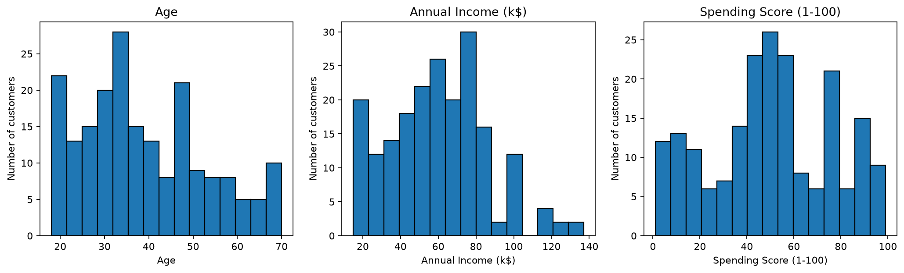
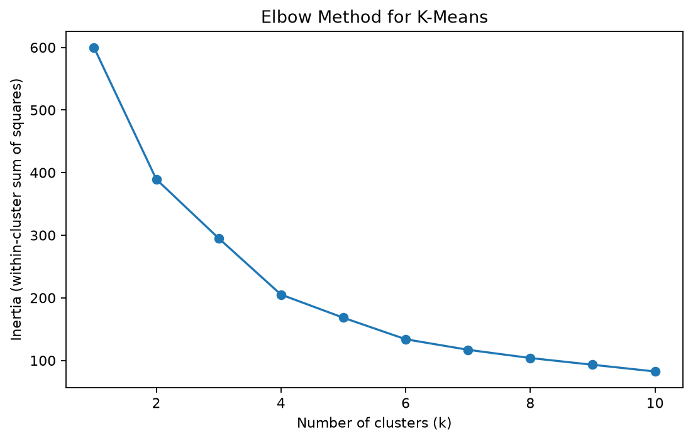
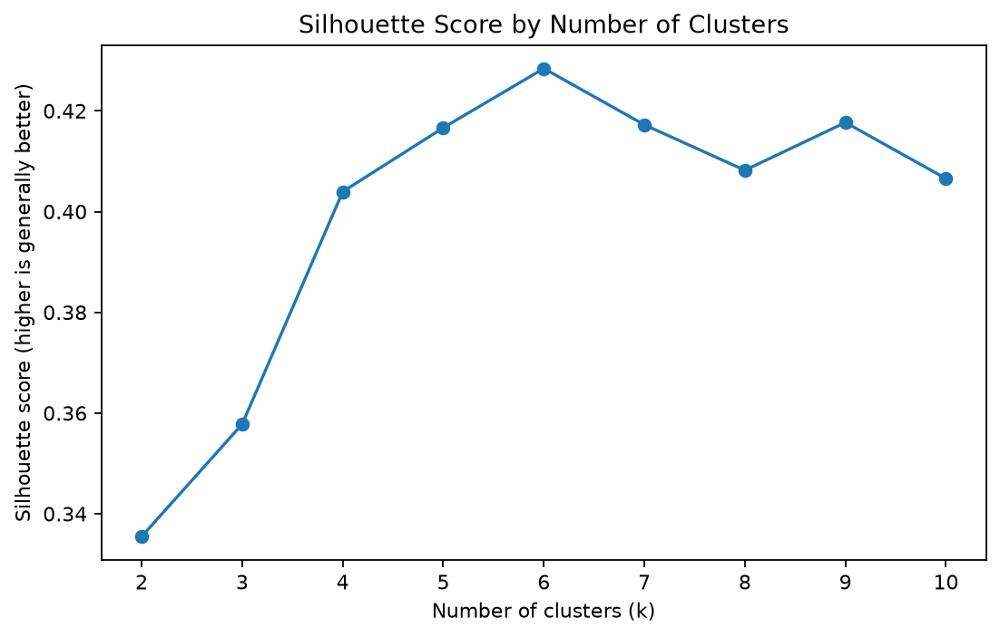
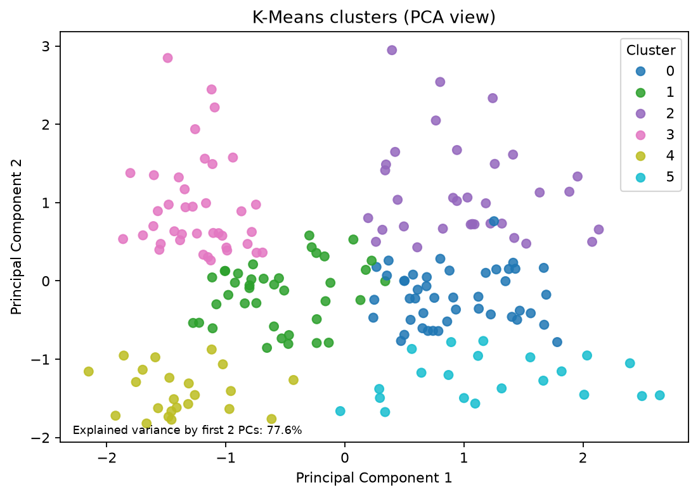
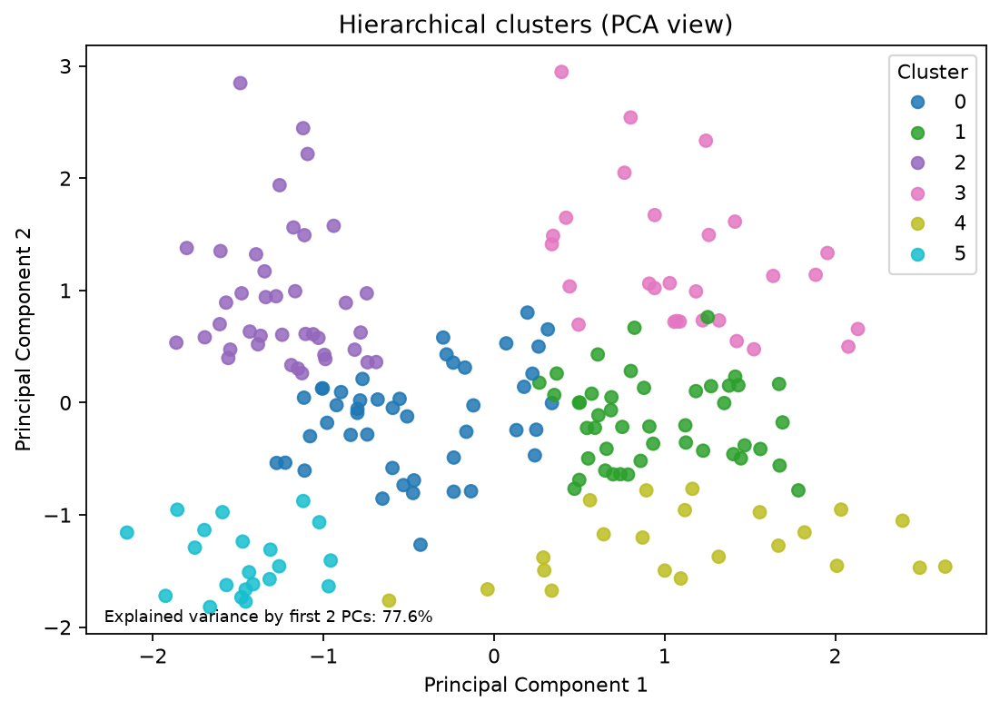
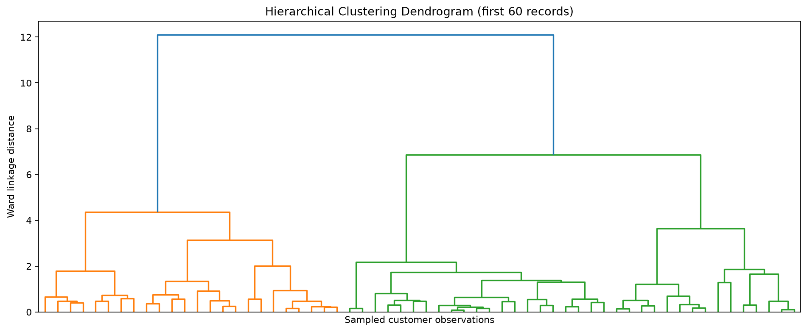

# Customer Segmentation Using Clustering

A Data Mining mini project that applies **K-Means clustering, Agglomerative Hierarchical Clustering, and Principal Component Analysis (PCA)** to identify customer groups based on demographic and spending characteristics.

## Project Overview

Customer segmentation helps businesses understand different customer groups and develop more targeted marketing strategies. This project applies unsupervised machine learning to group mall customers using their age, annual income, and spending score.

Two clustering algorithms are implemented and evaluated using internal clustering metrics. PCA is used to visualise the resulting clusters in two dimensions.

## Objectives

- Explore and preprocess customer data.
- Apply K-Means clustering.
- Apply Agglomerative Hierarchical Clustering.
- Compare clustering performance using evaluation metrics.
- Visualise clusters using PCA.
- Interpret customer groups using their average characteristics.

## Technologies Used

- Python
- Pandas and NumPy
- Scikit-learn
- Matplotlib and Seaborn
- SciPy
- PCA and StandardScaler

## Dataset

The project uses the Mall Customers dataset, containing customer demographic and spending information.

**Features used for clustering:**

| Feature | Description |
|---|---|
| Age | Customer age |
| Annual Income (k$) | Annual income in thousands of dollars |
| Spending Score (1–100) | Customer spending score |

The features are standardised before clustering. PCA is used for visualisation rather than as the input to the clustering algorithms.

The dataset is downloaded automatically when the program runs, provided an internet connection is available.

## Methodology

1. **Data loading:** Load the customer dataset.
2. **Data preprocessing:** Select the clustering features and standardise their values.
3. **Cluster selection:** Evaluate candidate cluster counts using silhouette scores and the elbow method.
4. **K-Means clustering:** Group customers based on feature similarity.
5. **Hierarchical clustering:** Apply Agglomerative Clustering to identify customer groups.
6. **Model evaluation:** Compare the algorithms using three internal evaluation metrics.
7. **PCA visualisation:** Project the data onto two principal components for visual inspection.
8. **Cluster profiling:** Calculate average customer characteristics for each cluster.

## Results

Both algorithms identified six clusters in this run.

| Evaluation Metric | K-Means | Hierarchical |
|---|---:|---:|
| Number of clusters | 6 | 6 |
| Silhouette Score (higher is better) | 0.4284 | 0.4201 |
| Davies–Bouldin Index (lower is better) | 0.8254 | 0.8521 |
| Calinski–Harabasz Score (higher is better) | 135.1021 | 127.9865 |

**Interpretation:** K-Means performed slightly better across all three internal evaluation metrics for this dataset and configuration. This does not establish that it is always superior to hierarchical clustering.

The first two principal components explain **77.57% of the total variance**, allowing the clusters to be visualised in two dimensions while retaining most of the variation in the standardised features.

## Visualisations

### 1. Feature Distributions



### 2. Elbow Method



### 3. Silhouette Scores by Cluster Count



### 4. K-Means Clusters Using PCA



### 5. Hierarchical Clusters Using PCA



### 6. Hierarchical Clustering Dendrogram



## Generated Outputs

The `outputs/` directory contains:

- `clustering_metrics.csv` — evaluation metrics for both algorithms.
- `cluster_profiles.csv` — average characteristics and sizes of the clusters.
- `customer_cluster_assignments.csv` — cluster labels assigned to individual customers.
- PNG files — generated charts and visualisations.

## How to Run the Project

### Prerequisites

- Python 3.10 or a compatible Python version supported by the dependencies.
- Git (optional, for cloning the repository).
- An internet connection for the initial dataset download.

### 1. Clone the repository

```bash
git clone https://github.com/Moussa986/Customer-Segmentation-Clustering.git
cd Customer-Segmentation-Clustering
```

### 2. Create a virtual environment

On Windows:

```powershell
python -m venv .venv
.venv\Scripts\Activate.ps1
```

If PowerShell blocks activation, you can use Command Prompt or run the Python executable directly from `.venv`.

### 3. Install dependencies

```bash
python -m pip install -r requirements.txt
```

### 4. Run the project

```bash
python main.py
```

After execution, check the `outputs/` directory for evaluation results, cluster profiles, customer assignments, and visualisations.

## Limitations

- The analysis uses a relatively small educational dataset and may not generalise to other customer populations.
- The dataset's spending score is provided; its original calculation is not established by this analysis.
- Clustering results depend on feature selection, scaling, algorithm settings, and the selected number of clusters.
- Internal evaluation metrics measure aspects of cluster structure, not actual business impact.
- The customer groups are descriptive patterns, not verified customer types or predictions of future behaviour.

## Conclusion

This project demonstrates an end-to-end unsupervised learning workflow for customer segmentation. K-Means and Agglomerative Hierarchical Clustering were implemented and compared, while PCA and cluster profiling helped interpret the resulting groups.

In this experiment, K-Means achieved slightly stronger internal evaluation scores. Further analysis on larger datasets and validation against business outcomes would be needed before using the segments for real-world marketing decisions.


## Author

**Moussa Issa**

B.Sc. Computer Science Student

Chandigarh University

---

*Academic mini project developed for the Data Mining subject.*